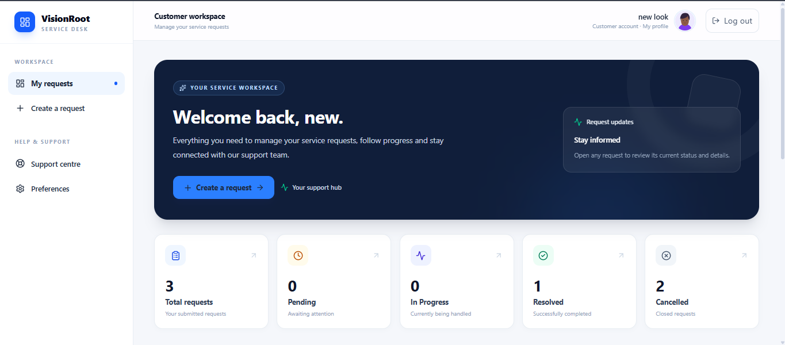
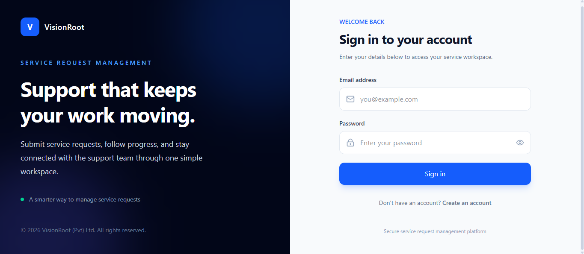
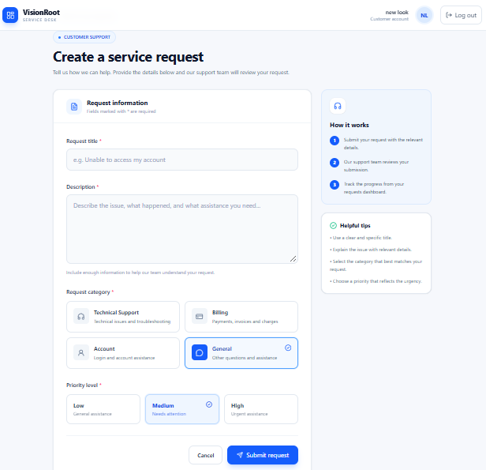
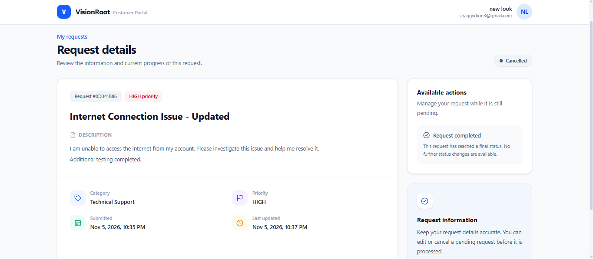
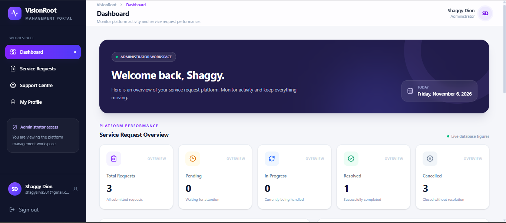
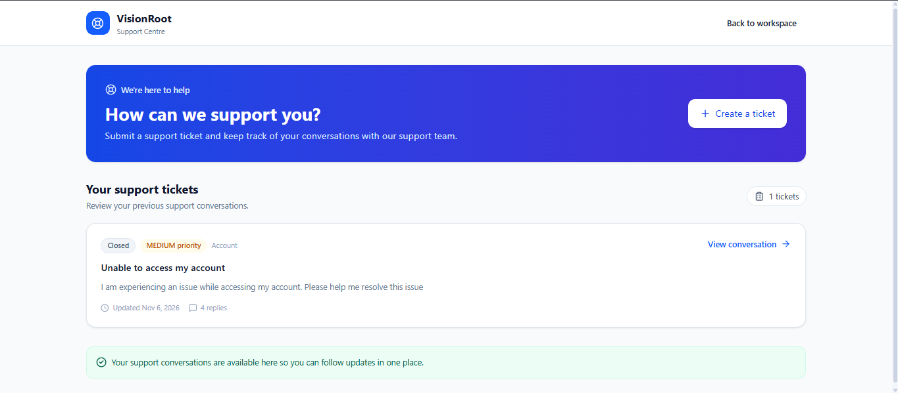
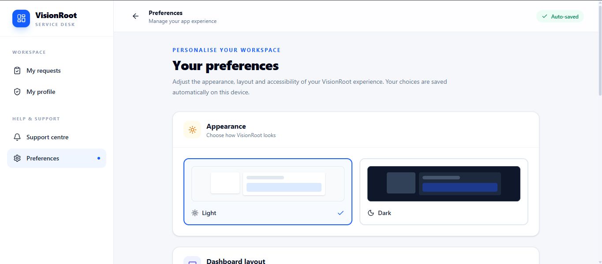

# VisionRoot – Service Request Management System

<p align="center">
  <strong>A Full-Stack Service Request Management Platform</strong>
  <br />
  Software Engineering Intern Technical Assignment
  <br />
  <strong>VisionRoot (Pvt) Ltd</strong>
</p>

<p align="center">
  
  
  
  
  
</p>

<p align="center">
  <a href="docs/api-documentation.md">API Documentation</a> •
  <a href="docs/database-schema.md">Database Schema</a> •
  <a href="#installation-and-setup">Installation Guide</a>
</p>

---

## Application Preview

<p align="center">
  
</p>

<p align="center">
  <em>A centralized platform for submitting, tracking, and managing customer service requests.</em>
</p>

## About the Project

VisionRoot Service Request Management System is a full-stack web application designed to streamline customer service request management.

Customers can register, submit service requests, track progress, manage eligible requests, and communicate with the support team. Administrators can manage requests across users, monitor service activities, update request statuses, manage user roles, and respond to support tickets.

### Key Highlights

- **User Management** – Registration, authentication, profile management, and role-based access.
- **Service Requests** – Create, view, edit, cancel, delete eligible requests, and track progress.
- **Admin Dashboard** – Centralized request management with search, filtering, sorting, and pagination.
- **Support Centre** – Support tickets with two-way communication between users and administrators.
- **User Preferences** – Application theme, display density, notification preferences, and accessibility settings.
- **Admin User Management** – View registered users and manage user roles.
- **Security** – Protected API endpoints, password hashing, session invalidation, validation, and authorization.
- **Automated Testing** – Backend unit and integration tests, along with end-to-end workflow verification.

## Technology Stack

| Layer | Technologies |
|---|---|
| Frontend | React, TypeScript, Vite |
| Backend | Node.js, Express.js, TypeScript |
| Database | MongoDB, Mongoose |
| Authentication | JWT, HTTP-only Cookies |
| Validation | Zod |
| Testing | Jest, ts-jest, Supertest |
| Styling | Tailwind CSS |
| API Communication | Axios |

## Screenshots

### User Interface

| Login | User Dashboard |
|---|---|
|  |  |

| Create Request | Request Details |
|---|---|
|  |  |

### Administration and Support

| Admin Dashboard | Support Centre |
|---|---|
|  |  |

### User Preferences

<p align="center">
  
</p>

---

## Table of Contents

1. [Project Overview](#1-project-overview)
2. [Project Objectives](#2-project-objectives)
3. [Features and Functionalities](#3-features-and-functionalities)
4. [Technology Stack](#4-technology-stack)
5. [System Architecture](#5-system-architecture)
6. [Project Directory Structure](#6-project-directory-structure)
7. [Database Design](#7-database-design)
8. [Business Rules](#8-business-rules)
9. [Authentication and Authorization](#9-authentication-and-authorization)
10. [REST API Documentation](#10-rest-api-documentation)
11. [Environment Configuration](#11-environment-configuration)
12. [Installation and Setup](#12-installation-and-setup)
13. [Running the Application](#13-running-the-application)
14. [Testing and Verification](#14-testing-and-verification)
15. [Security Implementation](#15-security-implementation)
16. [Error Handling and Validation](#16-error-handling-and-validation)
17. [Frontend Application](#17-frontend-application)
18. [Production Build](#18-production-build)
19. [Known Limitations and Future Improvements](#19-known-limitations-and-future-improvements)
20. [Developer Information](#20-developer-information)

---

# 1. Project Overview

The **VisionRoot Service Request Management System** is a full-stack web application developed to simplify the process of submitting, tracking, and managing customer service requests.

The application provides a centralized platform where customers can create service requests, monitor their progress, manage eligible requests, and communicate with the support team. Administrators can access a dedicated dashboard to review requests submitted by users, search and filter records, manage request statuses, and administer user accounts.

The application supports two primary roles:

- **USER:** Can register, log in, submit service requests, view personal request history, edit pending requests, manage eligible requests, and communicate with the support team.
- **ADMIN:** Can access the administration dashboard, manage requests across users, search and filter records, manage user roles, and handle support tickets.

The frontend is developed using React and TypeScript. The backend uses Node.js, Express, and TypeScript, with MongoDB for persistent data storage.

The system follows a modular frontend structure and a layered backend architecture to support maintainability, security, and separation of responsibilities.

## Project Information

| Property | Description |
|---|---|
| Project Name | VisionRoot Service Request Management System |
| Organization | VisionRoot (Pvt) Ltd |
| Project Type | Full-Stack Web Application |
| Frontend | React + TypeScript |
| Backend | Node.js + Express + TypeScript |
| Database | MongoDB |
| Database ODM | Mongoose |
| Architecture | Client-Server Architecture |
| API Style | RESTful API |
| Authentication | JWT with HTTP-only Cookies |
| User Roles | USER, ADMIN |

---

# 2. Project Objectives

The primary objectives are:

- Develop a user-friendly service request management platform.
- Allow customers to submit and track service requests.
- Provide administrators with centralized request management functionality.
- Implement secure user authentication.
- Enforce role-based access control.
- Protect request ownership and prevent unauthorized access.
- Implement controlled request status transitions.
- Support searching, filtering, sorting, and pagination.
- Provide a support communication system.
- Allow administrators to manage registered users and their roles.
- Validate user input on both frontend and backend.
- Maintain a modular and maintainable codebase.
- Provide automated backend tests and reliable API responses.

---

# 3. Features and Functionalities

## 3.1 User Authentication

- User registration.
- User login.
- User logout.
- Current authenticated user retrieval.
- Profile management.
- Profile avatar management.
- Password hashing.
- JWT-based authentication.
- HTTP-only authentication cookies.
- Session invalidation after logout.
- Protected frontend routes.

## 3.2 Service Request Management

Authenticated users can:

- Create new service requests.
- View their own submitted requests.
- View individual request details.
- Edit their own pending requests.
- Cancel their own pending requests.
- Delete eligible pending requests.
- Search their request history.
- Filter requests by status.
- Navigate through paginated results.

### Service Request Information

| Field | Description |
|---|---|
| Title | Short description of the issue |
| Description | Detailed explanation of the issue |
| Category | Type of service request |
| Priority | Request priority |
| Status | Current request status |
| Created At | Request creation timestamp |
| Updated At | Last modification timestamp |

### Available Categories

- `TECHNICAL_SUPPORT`
- `BILLING`
- `ACCOUNT`
- `GENERAL`

### Available Priorities

- `LOW`
- `MEDIUM`
- `HIGH`

### Available Statuses

- `PENDING`
- `IN_PROGRESS`
- `RESOLVED`
- `CANCELLED`

## 3.3 Administrator Dashboard

Administrators have access to a dedicated administration dashboard.

Features include:

- View service requests submitted by all users.
- View total matching request count.
- View request status summaries.
- Search requests by title and description.
- Filter requests by status.
- Filter requests by category.
- Filter requests by priority.
- View individual request details.
- Update request statuses according to business rules.
- Navigate through paginated results.
- Refresh request information.

## 3.4 Support Centre

The Support Centre provides a communication channel between users and administrators.

Features include:

- Create support tickets.
- View accessible support tickets.
- View ticket details and conversation history.
- Submit replies to support tickets.
- Allow administrators to respond to users.
- Update ticket statuses.
- Restrict users to their own tickets.
- Prevent replies to closed tickets.

### Support Ticket Statuses

- `OPEN`
- `IN_PROGRESS`
- `WAITING_FOR_USER`
- `RESOLVED`
- `CLOSED`

## 3.5 User Preferences

Authenticated users can manage application preferences, including:

- Theme selection.
- Display density.
- Email notification preferences.
- Request update notifications.
- Product announcement preferences.
- Reduced motion preference.

## 3.6 Admin User Management

Administrators can:

- View registered users.
- Review user account information.
- Change user roles between `USER` and `ADMIN`.
- Manage role assignments subject to administrator protection rules.

An administrator cannot demote their own account or demote the last remaining administrator.

## 3.7 User Interface

- Dedicated login and registration pages.
- User request dashboard.
- Service request creation form.
- Service request editing form.
- Individual request details page.
- Administrator dashboard.
- Support Centre interface.
- User management interface.
- User preferences page.
- Form validation and error messages.
- Loading indicators.
- Empty-state messages.
- Request status indicators.
- Responsive layouts.

---

# 4. Technology Stack

## 4.1 Frontend Technologies

| Technology | Purpose |
|---|---|
| React | Component-based user interface |
| TypeScript | Static typing |
| Vite | Development server and build tooling |
| Tailwind CSS v4 | Utility-first CSS styling |
| React Router | Client-side routing |
| TanStack Query | Server-state management and caching |
| Axios | HTTP communication |
| React Hook Form | Form management |
| Zod | Schema validation |
| @hookform/resolvers | Form validation integration |
| Lucide React | Interface icons |

## 4.2 Backend Technologies

| Technology | Purpose |
|---|---|
| Node.js | JavaScript runtime |
| Express.js | Backend REST API framework |
| TypeScript | Static typing |
| MongoDB | NoSQL database |
| Mongoose | MongoDB object modeling |
| Zod | Request validation |
| JSON Web Token | Authentication token generation and verification |
| bcryptjs | Password hashing |
| Helmet | HTTP security headers |
| CORS | Cross-origin request configuration |
| cookie-parser | Cookie parsing |
| express-rate-limit | API rate limiting |
| dotenv | Environment configuration |

## 4.3 Testing Technologies

| Technology | Purpose |
|---|---|
| Jest | Automated testing framework |
| ts-jest | TypeScript integration with Jest |
| Supertest | HTTP API integration testing |
| Node.js scripts | End-to-end workflow verification |

---

# 5. System Architecture

The application follows a client-server architecture.

## 5.1 High-Level Architecture

```text
+--------------------------------+
|           FRONTEND             |
|                                |
|       React + TypeScript       |
|                                |
|  Pages and Components          |
|  React Router                  |
|  TanStack Query                |
|  Axios API Client              |
+---------------+----------------+
                |
                | HTTP / JSON
                | HTTP-only Cookie
                |
+---------------v----------------+
|            BACKEND             |
|                                |
|       Node.js + Express        |
|          TypeScript            |
|                                |
|  Routes                        |
|     |                          |
|  Middleware                    |
|     |                          |
|  Controllers                   |
|     |                          |
|  Services                      |
|     |                          |
|  Repositories                  |
|     |                          |
|  Mongoose Models               |
+---------------+----------------+
                |
                | Database Operations
                |
+---------------v----------------+
|            DATABASE            |
|                                |
|             MongoDB            |
|                                |
|  Users                         |
|  Service Requests              |
|  Support Tickets               |
+--------------------------------+
```

## 5.2 Frontend Architecture

The frontend is organized by application features.

- **Features:** Contains application modules such as authentication, service requests, administration, and support.
- **Pages:** Route-level screens such as login, registration, request history, request details, and administration pages.
- **Components:** Reusable interface components and layout elements.
- **Services:** Handle communication with backend API endpoints.
- **Hooks:** Provide reusable data-fetching and mutation logic using TanStack Query.
- **Schemas:** Define form validation rules using Zod.
- **Types:** Define TypeScript interfaces and application types.
- **Lib:** Contains shared configuration such as the Axios API client and TanStack Query client.
- **Routes:** Defines application routes and protected route behavior.

## 5.3 Backend Layered Architecture

The backend follows a layered architecture.

| Layer | Responsibility |
|---|---|
| Routes | Define API endpoints |
| Middleware | Handle authentication, authorization, and errors |
| Controllers | Handle HTTP requests and responses |
| Services | Implement application business rules |
| Repositories | Perform database operations |
| Models | Define MongoDB schemas |
| Validators | Validate request data using Zod |
| Config | Manage environment and database configuration |
| Utils | Provide reusable utility functions |

### Request Processing Flow

```text
Client Request
     |
     v
Express Router
     |
     v
Authentication Middleware
     |
     v
Controller
     |
     v
Request Validation
     |
     v
Service Layer
     |
     v
Repository Layer
     |
     v
MongoDB
     |
     v
JSON Response
     |
     v
Frontend
```

This separation keeps business logic independent from HTTP handling and database implementation.

---

# 6. Project Directory Structure

The following structure highlights the main application directories and configuration files.

```text
visionroot-software-engineering-assignment/
|
+-- client/
|   +-- public/
|   +-- src/
|   |   +-- assets/
|   |   +-- components/
|   |   +-- features/
|   |   |   +-- admin/
|   |   |   +-- auth/
|   |   |   +-- requests/
|   |   +-- hooks/
|   |   +-- lib/
|   |   +-- pages/
|   |   +-- routes/
|   |   +-- schemas/
|   |   +-- services/
|   |   +-- types/
|   +-- .env.example
|   +-- package.json
|   +-- vite.config.ts
|
+-- server/
|   +-- src/
|   |   +-- config/
|   |   +-- controllers/
|   |   +-- middleware/
|   |   +-- models/
|   |   +-- repositories/
|   |   +-- routes/
|   |   +-- scripts/
|   |   +-- services/
|   |   +-- types/
|   |   +-- utils/
|   |   +-- validators/
|   |   +-- app.ts
|   |   +-- server.ts
|   +-- tests/
|   |   +-- integration/
|   |   +-- unit/
|   +-- .env.example
|   +-- jest.config.ts
|   +-- package.json
|   +-- tsconfig.json
|
+-- docs/
|   +-- screenshots/
|   +-- api-documentation.md
|   +-- database-schema.md
|
+-- .env.example
+-- .gitignore
+-- package.json
+-- README.md
```

The actual `.env` files and `node_modules` directories are excluded from version control.

---

# 7. Database Design

MongoDB is used as the primary database, with Mongoose providing schema definitions, validation, and database interaction.

The application uses collections for its main data entities, including:

1. `users`
2. `servicerequests`
3. `supporttickets`

User preference data is managed through the application's preference functionality.

## 7.1 User Collection

| Field | Data Type | Description |
|---|---|---|
| `_id` | ObjectId | Unique user identifier |
| name | String | User's full name |
| email | String | Unique email address |
| password | String | Hashed password |
| role | String | USER or ADMIN |
| tokenVersion | Number | Used for session invalidation |
| createdAt | Date | Account creation timestamp |
| updatedAt | Date | Last update timestamp |

### User Constraints

- Name is required and must contain 2–80 characters.
- Email is required, unique, normalized to lowercase, and trimmed.
- Password is required and stored as a hash.
- Role is restricted to `USER` or `ADMIN`.
- New registrations receive the `USER` role by default.

## 7.2 Service Request Collection

| Field | Data Type | Description |
|---|---|---|
| `_id` | ObjectId | Unique request identifier |
| user | ObjectId | Reference to the request owner |
| title | String | Request title |
| description | String | Detailed request description |
| category | String | Request category |
| priority | String | Request priority |
| status | String | Current request status |
| createdAt | Date | Creation timestamp |
| updatedAt | Date | Last update timestamp |

### Service Request Constraints

- Title is required and must contain 5–120 characters.
- Description is required and must contain 10–2000 characters.
- Category must be one of the supported categories.
- Priority must be `LOW`, `MEDIUM`, or `HIGH`.
- Status must be one of the supported statuses.
- Every request must belong to a valid user.

## 7.3 Support Ticket Collection

The support ticket functionality stores support requests and their conversation information.

The main ticket information includes:

- Ticket subject.
- Initial message.
- Category.
- Priority.
- Current status.
- User ownership.
- Conversation replies.
- Creation and update timestamps.

The supported ticket statuses are `OPEN`, `IN_PROGRESS`, `WAITING_FOR_USER`, `RESOLVED`, and `CLOSED`.

## 7.4 Entity Relationship

```text
+------------------------+
|          USER          |
+------------------------+
| _id                    |
| name                   |
| email                  |
| password               |
| role                   |
| tokenVersion           |
| createdAt              |
| updatedAt              |
+------------------------+
           |
           | 1
           |
           | Has many
           |
           | N
+------------------------+
|    SERVICE REQUEST     |
+------------------------+
| _id                    |
| user                   |
| title                  |
| description            |
| category               |
| priority               |
| status                 |
| createdAt              |
| updatedAt              |
+------------------------+
```

One user can create multiple service requests. Each service request belongs to one user through the `user` ObjectId reference.

## 7.5 Database Indexes

The service request model defines indexes to support common queries:

- User and creation date.
- Status and creation date.

The email field also has a unique constraint.

Detailed collection fields, relationships, constraints, and indexes are documented in [`docs/database-schema.md`](docs/database-schema.md).

---

# 8. Business Rules

## 8.1 User Permissions

A regular user:

- Can create service requests.
- Can retrieve only their own requests.
- Can edit only their own pending requests.
- Can cancel only their own pending requests.
- Can delete only eligible pending requests.
- Cannot assign themselves the `ADMIN` role.
- Cannot update requests to arbitrary statuses.
- Cannot access administrator-only resources.
- Can access only their own support tickets.

## 8.2 Administrator Permissions

An administrator:

- Can retrieve requests from all users.
- Can search and filter accessible requests.
- Can view request details.
- Can update request statuses according to permitted transitions.
- Can view and manage support tickets.
- Can respond to support tickets.
- Can view registered users.
- Can update user roles subject to administrator protection rules.
- Cannot change requests from final statuses to earlier statuses.

## 8.3 Request Status Lifecycle

```text
                +-----------+
                |  PENDING  |
                +-----------+
                   /     \
                  /       \
                 v         v
         +-------------+  +-------------+
         | IN_PROGRESS|  |  CANCELLED  |
         +-------------+  +-------------+
              /    \
             /      \
            v        v
     +----------+  +-------------+
     | RESOLVED |  |  CANCELLED  |
     +----------+  +-------------+
```

### Allowed Status Transitions

| Current Status | Allowed Next Statuses |
|---|---|
| PENDING | IN_PROGRESS, CANCELLED |
| IN_PROGRESS | RESOLVED, CANCELLED |
| RESOLVED | None |
| CANCELLED | None |

`RESOLVED` and `CANCELLED` are final statuses.

The backend checks the current status before allowing a transition. Regular users can only cancel their own pending requests.

## 8.4 Support Ticket Rules

- Regular users can access only their own tickets.
- Administrators can access tickets across users.
- User replies move tickets to `IN_PROGRESS`.
- Administrator replies move tickets to `WAITING_FOR_USER`.
- Replies to `CLOSED` tickets are rejected.
- Ticket status changes are restricted to administrators.

## 8.5 Administrator Protection Rules

- An administrator cannot demote their own account.
- The last remaining administrator cannot be demoted.
- Role changes are validated by the backend.

---

# 9. Authentication and Authorization

## 9.1 Registration Workflow

1. A user submits registration information.
2. The backend validates the data using Zod.
3. The email address is normalized.
4. The system checks whether the email already exists.
5. The password is hashed using bcryptjs.
6. The new user is created with the default `USER` role.
7. An authentication token is generated.
8. The token is returned through an HTTP-only cookie.

The registration endpoint does not allow users to select their own role.

## 9.2 Login Workflow

1. The user submits their email and password.
2. The backend validates the input.
3. The user account is retrieved from MongoDB.
4. bcryptjs compares the submitted password with the stored hash.
5. A JWT is generated after successful authentication.
6. The JWT is stored in an HTTP-only cookie.
7. The frontend retrieves the authenticated user information.

## 9.3 Authentication Middleware

Protected backend routes use authentication middleware.

The middleware:

- Reads the configured authentication cookie.
- Verifies the JWT.
- Validates the token payload.
- Checks the user identifier.
- Retrieves the corresponding account.
- Checks the stored token version.
- Attaches authenticated user information to the request.

## 9.4 Logout and Session Invalidation

When a user logs out:

1. The backend increments the user's token version.
2. The authentication cookie is cleared.
3. Previously issued tokens with an outdated token version are rejected.

This prevents previously issued sessions from remaining valid after logout.

## 9.5 Role-Based Access Control

The application supports two roles:

- `USER`
- `ADMIN`

Backend authorization and ownership checks are the primary security boundary. Frontend protected routes provide additional navigation-level protection.

---

# 10. REST API Documentation

Detailed endpoint descriptions, request examples, authentication requirements, and response formats are available in [API Documentation](docs/api-documentation.md).

## 10.1 Base URL

Local development API:

```text
http://localhost:5000/api/v1
```

The API uses JSON request and response bodies. Authentication is maintained through an HTTP-only cookie.

## 10.2 Health Check

| Method | Endpoint | Access | Description |
|---|---|---|---|
| GET | `/health` | Public | Check API availability |

Example:

```http
GET /api/v1/health
```

## 10.3 Authentication Endpoints

| Method | Endpoint | Access | Description |
|---|---|---|---|
| POST | `/auth/register` | Public | Register a new user |
| POST | `/auth/login` | Public | Authenticate a user |
| POST | `/auth/logout` | Authenticated | Log out and invalidate sessions |
| GET | `/auth/me` | Authenticated | Retrieve current user information |
| PUT | `/auth/profile` | Authenticated | Update profile |
| POST | `/auth/avatar` | Authenticated | Upload profile avatar |
| PUT | `/auth/avatar/preset` | Authenticated | Select preset avatar |

## 10.4 Service Request Endpoints

| Method | Endpoint | Access | Description |
|---|---|---|---|
| POST | `/requests` | Authenticated | Create a service request |
| GET | `/requests` | Authenticated | Retrieve accessible requests |
| GET | `/requests/:id` | Authenticated | Retrieve request details |
| PATCH | `/requests/:id` | Authenticated | Update request information |
| PATCH | `/requests/:id/status` | Authenticated | Change request status |
| DELETE | `/requests/:id` | Authenticated | Delete an eligible request |

Supported query parameters include:

- `search`
- `status`
- `category`
- `priority`
- `page`
- `limit`
- `sortBy`
- `sortOrder`

Regular users receive only their own requests. Administrators can retrieve requests from all users.

## 10.5 Support Centre Endpoints

| Method | Endpoint | Access | Description |
|---|---|---|---|
| POST | `/support` | USER | Create a support ticket |
| GET | `/support` | Authenticated | Retrieve accessible support tickets |
| GET | `/support/:id` | Authenticated | Retrieve ticket details |
| POST | `/support/:id/replies` | Authenticated | Add a reply |
| PATCH | `/support/:id/status` | ADMIN | Update ticket status |

## 10.6 User Preferences Endpoints

| Method | Endpoint | Access | Description |
|---|---|---|---|
| GET | `/preferences` | Authenticated | Retrieve user preferences |
| PATCH | `/preferences` | Authenticated | Update user preferences |

## 10.7 Admin User Management Endpoints

| Method | Endpoint | Access | Description |
|---|---|---|---|
| GET | `/users` | ADMIN | Retrieve registered users |
| PATCH | `/users/:id/role` | ADMIN | Update a user's role |

## 10.8 Response Structure

Illustrative successful response:

```json
{
  "success": true,
  "message": "Operation completed successfully.",
  "data": {}
}
```

Illustrative error response:

```json
{
  "success": false,
  "message": "An error occurred."
}
```

Validation errors may also include additional error details.

---

# 11. Environment Configuration

The application uses environment variables to separate configuration from application source code.

## 11.1 Backend Environment Variables

Create a file named:

`server/.env`

Example:

```env
NODE_ENV=development
PORT=5000
MONGODB_URI=mongodb://127.0.0.1:27017/visionroot_service_requests
CLIENT_URL=http://localhost:5173
JWT_SECRET=replace_with_a_long_random_secret_at_least_32_characters
JWT_EXPIRES_IN=1d
COOKIE_NAME=visionroot_token

ADMIN_NAME=System Administrator
ADMIN_EMAIL=admin@example.com
ADMIN_PASSWORD=replace_with_a_secure_password_at_least_12_characters
```

| Variable | Description |
|---|---|
| NODE_ENV | Application environment |
| PORT | Backend server port |
| MONGODB_URI | MongoDB connection string |
| CLIENT_URL | Frontend origin allowed by CORS |
| JWT_SECRET | Secret used for JWT signing and verification |
| JWT_EXPIRES_IN | Token expiration duration |
| COOKIE_NAME | Authentication cookie name |
| ADMIN_NAME | Initial administrator name |
| ADMIN_EMAIL | Initial administrator email |
| ADMIN_PASSWORD | Initial administrator password |

Use your own MongoDB connection string and secure credentials.

For MongoDB Atlas, use the connection string provided by your Atlas cluster.

## 11.2 Frontend Environment Variables

Create:

`client/.env`

Example:

```env
VITE_API_URL=http://localhost:5000/api/v1
```

| Variable | Description |
|---|---|
| VITE_API_URL | Backend API base URL |

## 11.3 Environment Security

- Never commit actual `.env` files.
- Never publish database credentials.
- Never publish JWT secrets.
- Use strong administrator credentials.
- Configure production secrets through the deployment environment.
- Use `.env.example` files as configuration templates.

---

# 12. Installation and Setup

## 12.1 Prerequisites

Install the following:

- Node.js (v20 or later recommended).
- npm.
- Git.
- MongoDB or a MongoDB Atlas account.

## 12.2 Clone the Repository

```bash
git clone https://github.com/SilvaDeShakila/visionroot-software-engineering-assignment.git
cd visionroot-software-engineering-assignment
```

## 12.3 Install Backend Dependencies

```bash
npm --prefix ./server install
```

## 12.4 Install Frontend Dependencies

```bash
npm --prefix ./client install
```

## 12.5 Configure Backend Environment

Create `server/.env` using `server/.env.example` as a reference.

Configure the MongoDB connection string, JWT secret, frontend URL, and administrator account details.

## 12.6 Configure Frontend Environment

Create `client/.env` using the example in Section 11.

## 12.7 Create the Administrator Account

After configuring the backend environment, execute:

```bash
npm --prefix ./server run seed:admin
```

The administrator seed script creates the configured administrator account or updates the existing account.

Use the configured administrator credentials to sign in.

---

# 13. Running the Application

The frontend and backend run as separate processes during development.

## 13.1 Start the Backend

Open a terminal at the project root:

```bash
npm --prefix ./server run dev
```

The backend runs at:

```text
http://localhost:5000
```

The server connects to MongoDB before accepting requests.

## 13.2 Start the Frontend

Open another terminal:

```bash
npm --prefix ./client run dev
```

The frontend runs at:

```text
http://localhost:5173
```

Open the frontend URL in a web browser.

## 13.3 Application Routes

| Route | Description | Access |
|---|---|---|
| `/login` | Login page | Public |
| `/register` | Registration page | Public |
| `/requests` | My service requests | Authenticated |
| `/requests/new` | Create a service request | Authenticated |
| `/requests/:id` | Request details | Authorized user |
| `/requests/:id/edit` | Edit a pending request | Authorized user |
| `/profile` | User profile | Authenticated |
| `/preferences` | User preferences | Authenticated |
| `/support` | Support Centre | Authenticated |
| `/admin` | Administrator dashboard | ADMIN |
| `/admin/requests` | Admin request management | ADMIN |
| `/admin/support` | Admin support management | ADMIN |
| `/admin/users` | User management | ADMIN |

The `/dashboard` route redirects authenticated users to `/requests`.

---

# 14. Testing and Verification

Testing was performed using automated backend tests, end-to-end workflow scripts, production build checks, linting, and manual browser/API verification.

## 14.1 Automated Backend Tests

Testing tools:

- Jest
- ts-jest
- Supertest

Run the test suite:

```bash
npm --prefix ./server test
```

### Authentication Validator Tests

The following scenarios are covered:

- Valid registration input.
- Invalid email addresses.
- Weak password rejection.
- Password confirmation mismatch.
- Email normalization.
- Valid login input.
- Missing password validation.

### Service Request Validator Tests

The following scenarios are covered:

- Valid request creation.
- Default priority.
- Invalid category.
- Invalid priority.
- Empty update rejection.
- Valid request update.
- Valid request status.
- Invalid request status.
- Default pagination and sorting.
- Maximum pagination limit.

### Service Request Service Tests

The following scenarios are covered:

- User request listing restricted to owned records.
- Administrator listing across all users.
- Rejection of edits to non-pending user requests.
- Rejection of invalid status transitions.
- Rejection of user cancellation of in-progress requests.
- Successful cancellation of an owned pending request.
- Rejection of unauthorized resource access.
- Successful update of an owned pending request.
- Successful administrator status transition.

### Support Ticket Service Tests

The following scenarios are covered:

- User ticket listing restricted to owned records.
- Administrator listing without an owner restriction.
- Rejection of unauthorized ticket access.
- Rejection of replies to closed tickets.
- Successful user replies and automatic `IN_PROGRESS` status.
- Successful administrator replies and automatic `WAITING_FOR_USER` status.
- Not-found support ticket handling.

### API Integration Tests

The following scenarios are covered:

- Health endpoint.
- Unknown route handling.
- Invalid registration.
- Invalid login.
- Authentication requirement for current user.
- Authentication requirement for request listing.
- Authentication requirement for request creation.

## 14.2 Latest Automated Backend Test Results

| Metric | Result |
|---|---:|
| Test Suites Passed | 6 |
| Total Test Suites | 6 |
| Tests Passed | 53 |
| Total Tests | 53 |
| Failed Tests | 0 |

**All 53 automated backend tests passed across 6 test suites.**

## 14.3 End-to-End Test Results

The application workflows were also verified using end-to-end test scripts.

| Workflow | Tests Passed |
|---|---:|
| Login | 3/3 |
| Registration | 4/4 |
| Protected Routes | 8/8 |
| User Workflow | 8/8 |
| Admin Workflow | 8/8 |
| Admin Status Management | 6/6 |
| Admin Cancellation | 11/11 |
| **Total** | **48/48** |

All 48 reported end-to-end checks passed.

## 14.4 Manual API Verification

The following behaviors were manually verified:

- User registration and login.
- Administrator login.
- Logout and session invalidation.
- Duplicate registration rejection.
- Unauthorized access rejection.
- Request ownership restrictions.
- Request creation and retrieval.
- Request editing restrictions.
- User cancellation restrictions.
- Invalid status transition rejection.
- Administrator request listing.
- Search and filtering.
- Sorting and pagination.
- Invalid query and payload rejection.
- Health endpoint.
- Error and not-found responses.

## 14.5 Frontend Manual Verification

### User Workflow

- Registration.
- Login.
- Logout.
- Empty request history.
- Create a service request.
- View request details.
- Edit a pending request.
- Verify updated request information.
- Cancel a pending request.
- Verify the final `CANCELLED` status.

### Administrator Workflow

- Administrator login.
- View requests from all users.
- Search and filter requests.
- View request details.
- Change `PENDING` to `IN_PROGRESS`.
- Change `IN_PROGRESS` to `RESOLVED`.
- Verify dashboard count updates.
- Verify cancelled and resolved records.
- Administrator logout.

### Support Centre Workflow

The following support ticket workflow was manually verified:

- User creates a support ticket.
- User views their ticket and conversation.
- Administrator views the submitted ticket.
- User and administrator exchange replies.
- Reply actions update the ticket status.
- Administrator changes the ticket to `RESOLVED`.
- Administrator changes the ticket to `CLOSED`.
- The saved ticket and conversation were checked in MongoDB Atlas.
- Replies to closed tickets are rejected.

### Admin User Management Workflow

The following role-management behavior was manually verified:

- Registered users are displayed in the admin interface.
- A user's role can be changed from `USER` to `ADMIN`.
- A user's role can be changed back to `USER`.
- The administrator count was checked after role changes.
- Self-demotion is prevented.

### Authorization Workflow

- A regular user attempted to access administrator routes.
- The frontend redirected unauthorized users to `/requests`.
- Backend role and ownership restrictions were also verified.

## 14.6 Frontend Quality Checks

### Lint

```bash
npm --prefix ./client run lint
```

**Result:** Successful.

### Frontend Production Build

```bash
npm --prefix ./client run build
```

**Result:** Successful.

### Backend Production Build

```bash
npm --prefix ./server run build
```

**Result:** Successful.

The frontend production build reports a JavaScript chunk-size warning, but the build completes successfully.

---

# 15. Security Implementation

The application includes the following security measures:

| Security Measure | Implementation |
|---|---|
| Password protection | bcryptjs password hashing |
| Authentication | JWT |
| Cookie security | HTTP-only authentication cookie |
| Session invalidation | Token version |
| Role authorization | Backend role checks |
| Resource ownership | User ID verification |
| Input validation | Zod |
| HTTP security headers | Helmet |
| Cross-origin control | CORS |
| API rate limiting | express-rate-limit |
| Request body limits | Express body size configuration |
| Error handling | Centralized error middleware |
| Secret management | Environment variables |

### Additional Security Details

- Registration does not accept a user-selected administrator role.
- Password hashes are excluded from normal user retrieval.
- Authentication cookies use secure settings in production.
- Invalid and expired authentication tokens are rejected.
- Unauthorized users cannot access other users' service requests.
- Support ticket ownership is enforced on the backend.
- Administrator-only endpoints require administrator authorization.
- Final request statuses cannot be changed through invalid transitions.
- Backend authorization is enforced independently of frontend route protection.
- Logout invalidates previously issued sessions through token version checks.

---

# 16. Error Handling and Validation

Zod is used to validate registration, login, service request, status update, and query data.

The backend uses centralized error-handling middleware to return consistent responses.

### HTTP Status Codes

| Status Code | Meaning |
|---|---|
| 200 | Successful request |
| 201 | Resource created |
| 400 | Invalid input or business rule violation |
| 401 | Authentication required or invalid session |
| 403 | Insufficient permissions |
| 404 | Resource or route not found |
| 409 | Duplicate resource conflict |
| 500 | Unexpected server error |

Validation is applied to:

- Registration data.
- Login data.
- Service request creation.
- Service request updates.
- Request status updates.
- Search and filtering parameters.
- Pagination and sorting parameters.
- Support ticket operations.
- User role updates.

The API returns structured JSON error messages and avoids exposing internal stack traces to clients.

---

# 17. Frontend Application

The application provides dedicated interfaces for regular users and administrators.

## 17.1 Authentication Pages

- Login page.
- Registration page.
- Password visibility controls.
- Form validation.
- API error feedback.

## 17.2 User Pages

**My Service Requests**

Displays the user's request history, status filters, request summaries, and request navigation.

**Create Service Request**

Allows users to submit new service requests with title, description, category, and priority.

**Request Details**

Displays request information, status, timestamps, and available actions.

**Edit Service Request**

Allows users to update their own pending requests.

**Profile and Preferences**

Provides profile management and application preference settings.

**Support Centre**

Allows users to create support tickets, view conversations, and communicate with administrators.

## 17.3 Administrator Pages

**Administration Dashboard**

Displays request summaries, request records, search, filters, pagination, and status management controls.

**Support Management**

Allows administrators to review support tickets, respond to users, and update ticket statuses.

**User Management**

Provides access to registered user information and role-management functionality.

## 17.4 Screenshots

The repository includes screenshots for the main application interfaces:

| Screenshot | File |
|---|---|
| Login Page | `login.png` |
| User Dashboard | `user-dashboard.png` |
| Create Request Page | `create-request.png` |
| Request Details | `request-details.png` |
| Administrator Dashboard | `admin-dashboard.png` |
| Support Centre | `support-centre.png` |
| User Preferences | `preferences.png` |

Screenshots are stored in:

```text
docs/screenshots/
```

---

# 18. Production Build

The frontend and backend have separate production build commands.

## 18.1 Frontend Production Build

```bash
npm --prefix ./client run build
```

The frontend build performs TypeScript compilation and Vite production bundling.

Generated production files:

```text
client/dist/
```

## 18.2 Backend Production Build

```bash
npm --prefix ./server run build
```

The backend TypeScript compiler generates JavaScript output in:

```text
server/dist/
```

## 18.3 Start Backend Production Server

```bash
npm --prefix ./server start
```

Production deployment requires:

- A reachable MongoDB database.
- Correct production environment variables.
- A configured frontend origin.
- A secure JWT secret.
- Appropriate hosting and network configuration.

The application has been verified through local production builds. A deployed production URL is not currently included.

---

# 19. Known Limitations and Future Improvements

The following areas can be improved in future development:

1. Add interactive OpenAPI/Swagger API documentation.
2. Expand frontend automated testing using Vitest and React Testing Library.
3. Increase backend test coverage for controllers and repositories.
4. Implement email notifications when request statuses change.
5. Add dashboard charts and advanced analytics.
6. Improve advanced request reporting.
7. Optimize frontend bundle splitting and loading performance.
8. Add production deployment configuration.
9. Expand accessibility testing.
10. Improve application monitoring and logging.

These are potential future improvements and are not claimed as completed functionality.

---

# 20. Developer Information

| Property | Details |
|---|---|
| Developer | Shakila De Silva |
| Organization | VisionRoot (Pvt) Ltd |
| Assignment | Software Engineering Intern Technical Assignment |
| Project | Service Request Management System |
| Academic Background | Bachelor of Information Technology (Hons.) in Software Engineering |
| Institution | ESOFT University |

---

## Final Note

The VisionRoot Service Request Management System demonstrates full-stack application development, REST API design, database integration, authentication, authorization, input validation, business rule enforcement, automated testing, and technical documentation.

The application was developed with a focus on modular architecture, maintainable code organization, secure request handling, and a practical user experience.


